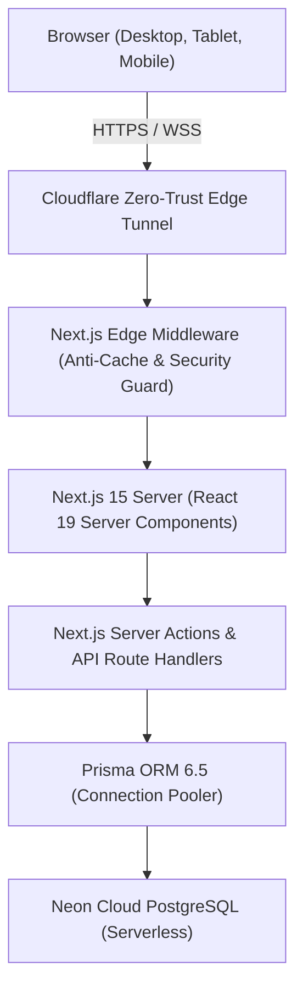
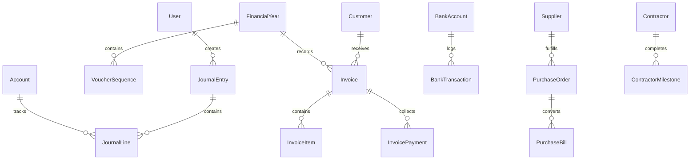

# Standard Roofs Books (SR-Books) — Master Technical Architecture & Project Documentation 🏛️⚙️

**System Identification:** Standard Roofs Books (SR-Books)  
**Enterprise Code:** `SR-BOOKS-ERP`  
**Target Enterprise:** Standard Roofs, Erode, Tamil Nadu  
**GSTIN:** `33AEWFS5187G1ZD` | **State Code:** `33 (Tamil Nadu)`  
**Architecture Classification:** Enterprise Cloud ERP & Double-Entry Accounting System  
**Engine Specification:** Fixed-Point Precision (`Decimal.js`), Next.js 15.5, React 19, Prisma 6.5, Neon PostgreSQL  
**Document Version:** 2.0 (Complete Technical Specification)  

---

## 📑 Table of Contents

1. [Architectural Overview & System Design](#1-architectural-overview--system-design)
2. [Full-Stack Topology & Infrastructure](#2-full-stack-topology--infrastructure)
3. [Exhaustive Database Schema & Model Dictionary (60 Models)](#3-exhaustive-database-schema--model-dictionary-60-models)
4. [Double-Entry Accounting Engine & GST Taxation Math](#4-double-entry-accounting-engine--gst-taxation-math)
5. [Security, Session Guard & Zero BFcache Architecture](#5-security-session-guard--zero-bfcache-architecture)
6. [Complete REST API & Server Action Specifications](#6-complete-rest-api--server-action-specifications)
7. [Universal UI Component Engine & Mathematical Spline Charting](#7-universal-ui-component-engine--mathematical-spline-charting)
8. [Data Protection, Point-in-Time Recovery & JSON Backups](#8-data-protection-point-in-time-recovery--json-backups)
9. [Production Deployment, Cloudflare Tunneling & CI/CD](#9-production-deployment-cloudflare-tunneling--cicd)

---

## 1. Architectural Overview & System Design

Standard Roofs Books (SR-Books) is an in-house enterprise Resource Planning (ERP) and double-entry accounting platform engineered for **Standard Roofs**, an industrial roofing and pre-engineered steel building (PEB) contractor in Erode, Tamil Nadu.

### 1.1 Core Engineering Principles
* **Mathematical Exactness:** Floating-point rounding anomalies common in standard JavaScript (`0.1 + 0.2 !== 0.3`) are strictly prohibited in the financial ledger. All currency computations use `Decimal.js` fixed-point arithmetic (`db.Decimal(15, 2)`).
* **Double-Entry Equilibrium:** No isolated numbers can exist in the ledger. Every financial transaction generates a minimum of one debit leg and one credit leg satisfying:
  $$\sum \text{Debits} = \sum \text{Credits}$$
* **Non-Destructive Data Retention:** Records are never hard-deleted via normal operations. The system enforces soft-delete flags (`isArchived = true`) to preserve immutable audit trails and tax records.
* **Ergonomic Zoho Design System:** Layouts, color palettes, and data density mirror Zoho Books and Stripe enterprise software, prioritizing speed, responsive tabular numbers (`tabular-nums`), and clean typography.

---

## 2. Full-Stack Topology & Infrastructure



### 2.1 Technology Stack Details
* **Frontend Framework:** Next.js `15.5.29` utilizing the App Router architecture.
* **UI Runtime:** React `19.0.0` with React Server Components (RSC) and server actions.
* **Styling & Design System:** Tailwind CSS `v4.0` with CSS variables for seamless light/dark slate themes.
* **Database & ORM:** Prisma ORM `6.5.0` backed by Neon Cloud Serverless PostgreSQL with pgBouncer pooling.
* **Spreadsheet Engine:** SheetJS (`xlsx`) `0.18.5` and `exceljs` `4.4.0` for universal Excel import/export.
* **Authentication:** Stateless JWT using `jose` `6.2.17` and password hashing via `bcryptjs` `3.0.2`.
* **Vector Icons:** `lucide-react` `0.475.0`.

---

## 3. Exhaustive Database Schema & Model Dictionary (60 Models)

The database schema (`prisma/schema.prisma`) comprises 60 relational models divided into operational domains:



### 3.1 Core Entity Dictionary

| Model | Table Name | Purpose | Key Attributes |
| :--- | :--- | :--- | :--- |
| **`User`** | `User` | Corporate user accounts & RBAC | `email`, `passwordHash`, `role`, `permissions`, `active` |
| **`FinancialYear`**| `FinancialYear`| Fiscal year bounds & lock status | `name` ("2026-27"), `startDate`, `endDate`, `isLocked`, `isCurrent` |
| **`VoucherSequence`**| `VoucherSequence`| Sequential numbering engine | `voucherType`, `prefix` ("SR/26-27/"), `nextNumber`, `paddingLength` |
| **`Account`** | `Account` | Chart of accounts general ledger | `code` ("1010"), `name`, `type`, `subType`, `currentBalance` |
| **`JournalEntry`** | `JournalEntry` | Master double-entry voucher header | `entryNumber` ("JV/26-27/0001"), `date`, `voucherType`, `totalDebit`, `totalCredit`, `status` |
| **`JournalLine`** | `JournalLine` | Individual debit/credit lines | `accountId`, `debit`, `credit`, `narration`, `projectId`, `customerId` |
| **`Customer`** | `Customer` | Accounts Receivable clients | `name`, `gstin`, `pan`, `billingAddress`, `shippingAddress`, `creditPeriodDays` |
| **`Invoice`** | `Invoice` | Sales GST tax invoices | `invoiceNumber` ("SR/26-27/0033"), `subTotal`, `cgstTotal`, `sgstTotal`, `totalAmount`, `balanceDue`, `status` |
| **`InvoiceItem`** | `InvoiceItem` | Invoice line items | `description`, `hsnCode`, `quantity`, `unitRate`, `cgstRate`, `sgstRate`, `totalAmount` |
| **`Supplier`** | `Supplier` | Creditors & material vendors | `name`, `gstin`, `pan`, `bankName`, `accountNumber`, `ifsc` |
| **`PurchaseBill`** | `PurchaseBill` | Vendor accounts payable bills | `billNumber`, `supplierId`, `billDate`, `dueDate`, `totalAmount`, `balanceDue` |
| **`BankAccount`** | `BankAccount` | Bank accounts & treasury | `bankName` ("ICICI Bank"), `accountNumber` ("155205003161"), `ifsc`, `currentBalance` |
| **`BankTransaction`**| `BankTransaction`| Bank deposit/withdrawal ledger | `voucherNumber`, `type`, `amount`, `payeeOrPayer`, `isReconciled` |
| **`CashBookEntry`**| `CashBookEntry`| Petty cash daily transactions | `entryType` (`INFLOW`/`OUTFLOW`), `amount`, `partyName`, `runningBalance` |
| **`DailyCashClosing`**| `DailyCashClosing`| Cash verification with denominations | `date`, `bookBalance`, `physicalBalance`, `discrepancy`, `denominations` |
| **`Project`** | `Project` | Roofing & PEB site contracts | `code` ("SR-PRJ-2601"), `name`, `contractValue`, `siteLocation`, `status` |
| **`MachineAsset`** | `MachineAsset` | SRM heavy tools & plant assets | `assetCode` ("SRM-WLD-01"), `name`, `srFinalCount`, `status` |
| **`CargoVehicle`** | `CargoVehicle` | Transport & logistics vehicles | `registrationNumber`, `vehicleType`, `capacityTons`, `status` |
| **`Contractor`** | `Contractor` | Subcontractor directory | `name`, `pan`, `tdsRate`, `specialization`, `active` |
| **`ContractorMilestone`**| `ContractorMilestone`| Subcontractor progress claims | `contractorId`, `projectId`, `milestoneName`, `claimAmount`, `tdsAmount`, `netPayable` |
| **`LabourMuster`** | `LabourMuster` | Daily labour shift attendance | `date`, `labourId`, `shiftType`, `overtimeHours`, `wageRate`, `netPayable` |
| **`RoofingPriceItem`**| `RoofingPriceItem`| 290 catalog master items | `itemCode`, `name`, `category`, `hsnSacCode`, `unitPrice`, `taxRate` |
| **`AuditLog`** | `AuditLog` | Immutable system audit trail | `userId`, `action`, `entityName`, `entityId`, `details`, `ipAddress` |
| **`CompanySettings`**| `CompanySettings`| Global enterprise parameters | `companyName`, `gstin`, `pan`, `address`, `phone`, `email` |

---

## 4. Double-Entry Accounting Engine & GST Taxation Math

### 4.1 Statutory Indian GST Rules & Calculations
* **Place of Supply Logic:**
  * When `Customer.stateCode === "33"` (Tamil Nadu intra-state transaction):
    $$\text{Taxable Value} = \sum (\text{Qty} \times \text{Rate})$$
    $$\text{CGST Amount} = \text{Taxable Value} \times 9\%$$
    $$\text{SGST Amount} = \text{Taxable Value} \times 9\%$$
    $$\text{IGST Amount} = 0$$
  * When `Customer.stateCode !== "33"` (Inter-state transaction):
    $$\text{CGST Amount} = 0, \quad \text{SGST Amount} = 0$$
    $$\text{IGST Amount} = \text{Taxable Value} \times 18\%$$
* **Rounding / Adjustment (Account 5999):**
  $$\text{Invoice Total} = \text{Round}(\text{Taxable Value} + \text{Taxes})$$
  $$\text{Adjustment} = \text{Invoice Total} - (\text{Taxable Value} + \text{Taxes})$$

### 4.2 Balanced Double-Entry Journal Posting Matrix

| Transaction Type | Debit Ledger (Dr) | Credit Ledger (Cr) | Mathematical Integrity |
| :--- | :--- | :--- | :--- |
| **Sales Tax Invoice** | **Dr** Debtors Control (`1030`) | **Cr** Sales Revenue (`4010`)<br>**Cr** Output CGST (`2020`)<br>**Cr** Output SGST (`2030`)<br>**Cr/Dr** Round Off (`5999`) | $\text{Dr}(1030) = \text{Cr}(4010) + \text{Cr}(2020) + \text{Cr}(2030) \pm \text{RoundOff}$ |
| **Customer Payment Received** | **Dr** ICICI Bank (`1020`) | **Cr** Debtors Control (`1030`) | $\text{Dr}(1020) = \text{Cr}(1030)$ |
| **Vendor Purchase Bill** | **Dr** Material Purchases (`5010`)<br>**Dr** Input CGST (`1050`)<br>**Dr** Input SGST (`1060`) | **Cr** Creditors Control (`2010`) | $\text{Dr}(5010) + \text{Dr}(1050) + \text{Dr}(1060) = \text{Cr}(2010)$ |
| **Bank Contra (Cash Deposit)**| **Dr** ICICI Bank (`1020`) | **Cr** Cash in Hand (`1010`) | $\text{Dr}(1020) = \text{Cr}(1010)$ |
| **Bank Contra (Cash Withdrawal)**| **Dr** Cash in Hand (`1010`) | **Cr** ICICI Bank (`1020`) | $\text{Dr}(1010) = \text{Cr}(1020)$ |
| **Contractor Milestone Claim** | **Dr** Sub-Contractor Charges (`5020`)| **Cr** Contractor Payable (`2010`)<br>**Cr** TDS Payable Sec 194C (`2040`) | $\text{Dr}(5020) = \text{Cr}(2010) + \text{Cr}(2040)$ |

---

## 5. Security, Session Guard & Zero BFcache Architecture

### 5.1 HTTP Anti-Cache Response Headers (`src/middleware.ts`)
To prevent sensitive financial and tax information from residing in browser disk caches:
```typescript
const response = NextResponse.next();
response.headers.set('Cache-Control', 'no-store, no-cache, must-revalidate, proxy-revalidate');
response.headers.set('Pragma', 'no-cache');
response.headers.set('Expires', '0');
response.headers.set('Surrogate-Control', 'no-store');
return response;
```

### 5.2 Client Session Guard (`src/components/layout/AppShell.tsx`)
Prevents unauthorized history traversal via the browser's Back/Forward Cache (BFcache):
```typescript
useEffect(() => {
  const handlePageShow = (event: PageTransitionEvent) => {
    if (event.persisted) {
      window.location.reload();
    }
  };
  window.addEventListener('pageshow', handlePageShow);
  return () => window.removeEventListener('pageshow', handlePageShow);
}, []);
```

---

## 6. Complete REST API & Server Action Specifications

| Endpoint | Method | Role | Payload Schema | Response Format |
| :--- | :--- | :--- | :--- | :--- |
| `/api/auth/login` | `POST` | Public | `{ email, password }` | `{ success: true, user: { id, name, role } }` |
| `/api/auth/logout` | `POST` | Any | None | Sets expired cookie, flushes session |
| `/api/invoices` | `GET` | Accountant+ | Query: `?status=&page=&search=` | `{ invoices: Invoice[], totalCount: number }` |
| `/api/invoices` | `POST` | Accountant+ | `{ customerId, date, dueDate, items: [...] }` | `{ success: true, invoice: Invoice, journalId }` |
| `/api/invoices/[id]` | `DELETE` | Accountant+ | None | Soft-deletes: sets `isArchived: true` |
| `/api/banking/contra` | `POST` | Accountant+ | `{ fromAccountId, toAccountId, amount, date }` | `{ success: true, voucherNumber: string }` |
| `/api/banking/reconcile`| `POST` | Accountant+ | `{ transactionId, statementRef, reconciledDate }` | `{ success: true, updatedBalance: number }` |
| `/api/cashbook/closing`| `POST` | Accountant+ | `{ date, denominations: { 2000, 500... }, physicalTotal }` | `{ success: true, status: "BALANCED" \| "DISCREPANCY" }` |
| `/api/settings/backup` | `GET` | Super Admin | None | Application/json attachment with full table dump |
| `/api/settings/fy-lock`| `POST` | Super Admin | `{ financialYearId, isLocked: boolean }` | `{ success: true, lockedStatus: boolean }` |

---

## 7. Universal UI Component Engine & Mathematical Spline Charting

### 7.1 Master Header with Analytics (`ModuleHeaderWithAnalytics.tsx`)
A unified modular wrapper providing:
* 4 real-time KPI trend cards with delta pills.
* Smooth collapsible visual analytics strip with responsive SVG charting.
* Standardized Zoho module toolbar with status filter dropdown, search bar with debounce, bulk import modal launcher, Excel export, and PDF print buttons.

### 7.2 Mathematical Cubic Bézier Spline Chart Engine
Used in the Executive Command Center to render silky smooth curves:
```typescript
function getSmoothSpline(points: { x: number; y: number }[]): string {
  if (points.length === 0) return "";
  let d = `M ${points[0].x.toFixed(1)} ${points[0].y.toFixed(1)}`;
  for (let i = 0; i < points.length - 1; i++) {
    const p0 = points[Math.max(0, i - 1)];
    const p1 = points[i];
    const p2 = points[i + 1];
    const p3 = points[Math.min(points.length - 1, i + 2)];

    const cp1x = p1.x + (p2.x - p0.x) / 5;
    const cp1y = p1.y + (p2.y - p0.y) / 5;
    const cp2x = p2.x - (p3.x - p1.x) / 5;
    const cp2y = p2.y - (p3.y - p1.y) / 5;

    d += ` C ${cp1x.toFixed(1)} ${cp1y.toFixed(1)}, ${cp2x.toFixed(1)} ${cp2y.toFixed(1)}, ${p2.x.toFixed(1)} ${p2.y.toFixed(1)}`;
  }
  return d;
}
```

---

## 8. Data Protection, Point-in-Time Recovery & JSON Backups

### 8.1 Non-Destructive Data Protection
Every critical accounting model implements soft-delete semantics:
```prisma
isArchived  Boolean   @default(false)
archivedAt  DateTime?
```
Database indexes filter by `WHERE isArchived = false` for active operational views while preserving records for statutory auditing and historical reporting.

### 8.2 JSON Cold Backup & Restoration
* **Trigger:** Accessed via **Settings > Database Backup** (`/api/settings/backup`).
* **Format:** Generates an encrypted JSON payload containing relational dumps of all tables.
* **Restoration:** Restores complete ledger state in case of platform migration.

---

## 9. Production Deployment, Cloudflare Tunneling & CI/CD

### 9.1 Production Compilation
```bash
# Build optimized production bundle
npm run build

# Start Next.js server on designated port
npm run start
```

### 9.2 Zero-Trust Cloudflare Tunnel
```bash
cloudflared tunnel --url http://localhost:3000
```
This enables secure external connectivity to the Next.js server without requiring public IP exposure or router port forwarding.
