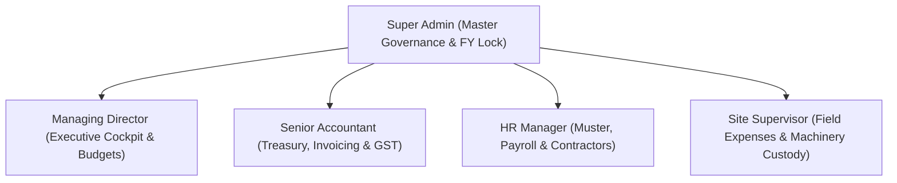

# Standard Roofs Books (SR-Books) — Comprehensive Operations Manual & A-to-Z User Guide 📘

**System Name:** Standard Roofs Books (SR-Books)  
**Enterprise Entity:** Standard Roofs  
**Headquarters:** 144/A, Vellakkal Medu, Villarasampatti, Nasiyanur (Post), Erode, Tamil Nadu – 638107  
**GSTIN / UIN:** `33AEWFS5187G1ZD` | **State Code:** `33 (Tamil Nadu)`  
**Primary Bank:** ICICI Bank (A/C: `155205003161`, IFSC: `ICIC0001552`, Branch: Kagam, Erode)  
**Active Financial Year:** FY 2026-27 (01-Apr-2026 to 31-Mar-2027)  
**Calculation Precision:** `Decimal.js` Fixed-Point Arithmetic (Zero Float Discrepancy)  
**Document Edition:** Master Enterprise Release 2.0  

---

## 📑 Table of Contents

1. [System Fundamentals & User Roles](#1-system-fundamentals--user-roles)
2. [Executive Command Center & Visual Dashboard (`/`)](#2-executive-command-center--visual-dashboard-)
3. [Workspace 1: Accounting & GST (17 Core Modules)](#3-workspace-1-accounting--gst-17-core-modules)
   - 3.1 [Sales & GST Invoicing (`/invoices`)](#31-sales--gst-invoicing-invoices)
   - 3.2 [Quotes & Pre-Construction Estimates (`/estimates`)](#32-quotes--pre-construction-estimates-estimates)
   - 3.3 [Sales Orders & Commitments (`/sales-orders`)](#33-sales-orders--commitments-sales-orders)
   - 3.4 [Customers & Accounts Receivable (`/customers`)](#34-customers--accounts-receivable-customers)
   - 3.5 [Credit & Debit Notes (`/credit-notes`)](#35-credit--debit-notes-credit-notes)
   - 3.6 [Price Catalog Master — 290 Items (`/price-catalog`)](#36-price-catalog-master--290-items-price-catalog)
   - 3.7 [Recurring Invoicing Templates (`/recurring`)](#37-recurring-invoicing-templates-recurring)
   - 3.8 [Vendors & Creditors Master (`/vendors`)](#38-vendors--creditors-master-vendors)
   - 3.9 [Purchase Orders (`/purchase-orders`)](#39-purchase-orders-purchase-orders)
   - 3.10 [Vendor Bills & ITC Tracking (`/bills`)](#310-vendor-bills--itc-tracking-bills)
   - 3.11 [Payments Made (`/payments-made`)](#311-payments-made-payments-made)
   - 3.12 [Banking, Contra & ICICI Treasury (`/banking`)](#312-banking-contra--icici-treasury-banking)
   - 3.13 [Daily Cash Book & Physical Denomination Count (`/cashbook`)](#313-daily-cash-book--physical-denomination-count-cashbook)
   - 3.14 [Chart of Accounts & General Ledger (`/accounts`)](#314-chart-of-accounts--general-ledger-accounts)
   - 3.15 [Manual Journal Entries & Vouchers (`/vouchers`)](#315-manual-journal-entries--vouchers-vouchers)
   - 3.16 [Capital Transactions & Business Loans (`/capital`)](#316-capital-transactions--business-loans-capital)
   - 3.17 [Financial & Statutory GST Reports (`/reports`)](#317-financial--statutory-gst-reports-reports)
4. [Workspace 2: Site Operations, Material & Fleet (5 Modules)](#4-workspace-2-site-operations-material--fleet-5-modules)
   - 4.1 [Projects & Site Costing (`/projects`)](#41-projects--site-costing-projects)
   - 4.2 [SRM Heavy Tools & Machine Custody (`/machines`)](#42-srm-heavy-tools--machine-custody-machines)
   - 4.3 [Fleet & Cargo Vehicles (`/fleet`)](#43-fleet--cargo-vehicles-fleet)
   - 4.4 [Yard Stock Inventory (`/inventory`)](#44-yard-stock-inventory-inventory)
   - 4.5 [Site Expenses & Field Claims (`/expenses`)](#45-site-expenses--field-claims-expenses)
5. [Workspace 3: Labour & Contractors (2 Modules)](#5-workspace-3-labour--contractors-2-modules)
   - 5.1 [Contractors Master & Milestone Claims (`/contractors`)](#51-contractors-master--milestone-claims-contractors)
   - 5.2 [Labour Master, Muster Rolls & Advances (`/labour`)](#52-labour-master-muster-rolls--advances-labour)
6. [Workspace 4: Operations, Security & Governance (5 Modules)](#6-workspace-4-operations-security--governance-5-modules)
   - 6.1 [Maker-Checker Approvals Queue (`/approvals`)](#61-maker-checker-approvals-queue-approvals)
   - 6.2 [Customer & Supplier Advances (`/advances`)](#62-customer--supplier-advances-advances)
   - 6.3 [Statutory Immutable Audit Trail (`/audit`)](#63-statutory-immutable-audit-trail-audit)
   - 6.4 [Users & Role-Based Permissions (`/users`)](#64-users--role-based-permissions-users)
   - 6.5 [Company Settings, FY Locking & JSON Backups (`/settings`)](#65-company-settings-fy-locking--json-backups-settings)
7. [Universal System Engines & Shared Operations](#7-universal-system-engines--shared-operations)
   - 7.1 [Turnkey Bulk Excel Import Engine](#71-turnkey-bulk-excel-import-engine)
   - 7.2 [Universal Export Engine (Excel & Landscape A4 PDF)](#72-universal-export-engine-excel--landscape-a4-pdf)
   - 7.3 [Non-Destructive Soft-Delete & 1-Click Restore Lifecycle](#73-non-destructive-soft-delete--1-click-restore-lifecycle)
8. [Master Chart of Accounts & General Ledger Directory](#8-master-chart-of-accounts--general-ledger-directory)
9. [Official GST & HSN/SAC Code Master Reference](#9-official-gst--hsnsac-code-master-reference)

---

## 1. System Fundamentals & User Roles

### 1.1 Secure Login, JWT Session & Anti-Cache Security Guard
* **Authentication Portal:** Access the application via `http://localhost:3000/login` or your designated secure Cloudflare Tunnel endpoint.
* **Encrypted Token:** Authenticated sessions issue an HTTP-only, `SameSite=Lax`, `Secure` JWT cookie containing user identity, role, and workspace permissions.
* **Zero BFcache Leak Protection:** Standard Roofs financial data is strictly guarded against browser back-button caching. When a user logs out:
  1. The authentication cookie is destroyed via `/api/auth/logout`.
  2. Local storage and application cache are flushed.
  3. `window.location.replace('/login')` replaces the browser history entry.
  4. If an unauthorized user presses the Back (`←`) arrow on the browser, an active `pageshow` listener detects cache restoration (`event.persisted === true`) and instantly enforces a server-side redirect to `/login`.

### 1.2 User Role Hierarchy

* **`SUPER_ADMIN`:** Full master privileges across all 28 modules, financial year period locking, system configuration, JSON backup/restore, and user permission delegation.
* **`MANAGING_DIRECTOR`:** Executive oversight, high-level financial reports, balance sheets, project budget tracking, and banking liquidity approvals.
* **`ACCOUNTANT`:** Full double-entry bookkeeping, GST tax invoices, customer collections, vendor bills, ICICI reconciliation, cash book closings, and GSTR filing summaries.
* **`HR_MANAGER`:** Daily labour muster, staff wage payroll, sub-contractor agreements, milestone verification, and wage advance registers.
* **`SITE_SUPERVISOR`:** Mobile-first site expense logging, tool custody handovers, cargo vehicle trip tracking, and yard material issue requests.

---

## 2. Executive Command Center & Visual Dashboard (`/`)

The home dashboard is an executive-grade financial command cockpit:

### 2.1 The 4 Primary Fintech KPI Cards
1. **Total Receivables (AR):** Total outstanding billings (e.g. Sabari Invoices `#33` and `#34`). Features an inline SVG upward trajectory sparkline, `+12.4%` cycle growth pill, and a dual-tone progress track (35% Current, 65% 16–30 Days).
2. **Cash & Bank Liquidity:** Live verified liquidity across all accounts (ICICI Bank A/C `155205003161` balance of ₹ 24,03,272.00). Displays a reservoir sparkline and safe operational runway badge (`18.4 Mo Runway`).
3. **Works Turnover (FYTD):** Fiscal year-to-date invoiced contract collections.
4. **Net Operating Profit:** Net earnings after direct material purchases, equipment diesel, heavy crane logistics, and labour wages.

### 2.2 Cash Flow & Working Capital Trajectory (Cubic Spline Curve)
* **Smooth Mathematical Curve:** Employs a multi-point cubic Bézier spline (`getSmoothSpline`) to plot cash flow from April 2026 to March 2027.
* **Seasonal Industrial Progression:** Accurately reflects peak mobilization in Q1, heavy PEB fabrication in Q2, monsoon sheeting in Q3, and annual contract closures in Q4.
* **Verified Active Anchor:** The active month (November) pulses with an emerald status dot representing live verified ledger balances.
* **Interactive Tooltip:** Hovering over any month reveals:
  * Inflow Receipts (Collections)
  * Outflow Disbursements (Site Costs)
  * Net Cash Surplus
  * Closing Liquidity Reserve
* **Time Range Toggle:** Easily switch between `12M (Full Year)`, `6M (Half Year)`, and `Quarters (Q1–Q4)`.

### 2.3 Income vs. Direct Site Costs & Operating Expense Allocation
* **Dual-Column Bar Chart:** Prominent full-height green bars (Collections) vs. rose/amber bars (Direct Costs) across all 12 months with gross profit percentage pills.
* **Radial Donut Breakdown:** Shows proportional distribution across the 5 commercial roofing heads:
  * Raw Material (PEB Coils, HR Plates, Sheets): **45%** (₹ 18,45,000)
  * Labour Muster & Skilled Erection: **24%** (₹ 9,84,000)
  * Heavy Crane, Trailer & Logistics: **14%** (₹ 5,74,000)
  * Machinery Fuel & Generator Power: **10%** (₹ 4,10,000)
  * Fasteners, Self-Drilling Screws & Consumables: **7%** (₹ 2,87,000)

### 2.4 Summary Table vs. Visual View Toggle
Switch between **Visual View** and **Summary Table** to inspect an audit-ready 12-month ledger schedule with single-click **Export Schedule (.xlsx)** functionality.

---

## 3. Workspace 1: Accounting & GST (17 Core Modules)

### 3.1 Sales & GST Invoicing (`/invoices`)
* **Invoice Numbering Engine:** Generates sequence numbers based on active financial year bounds (e.g. `SR/26-27/0033`).
* **Taxation Rules:**
  * **Intra-State (Customer in Tamil Nadu - State Code 33):** Calculates **CGST @ 9%** + **SGST @ 9%**.
  * **Inter-State (Customer Outside Tamil Nadu):** Calculates **IGST @ 18%**.
* **Round-Off Adjustment (Account 5999):** Automatically rounds invoice totals to the nearest integer and balances the ledger.
* **Automatic Double-Entry Posting:**
  * **Dr** Accounts Receivable Control (`1030`) — Full Rounded Total
  * **Cr** Works Contract Sales Revenue (`4010`) — Taxable Value
  * **Cr** Output CGST Payable (`2020`) — CGST Amount
  * **Cr** Output SGST Payable (`2030`) — SGST Amount
  * **Cr/Dr** Round-Off Adjustment (`5999`) — Fraction
* **Official Zoho Books Tax Invoice Print Engine (`/invoices/[id]/print`):**
  * Top-left Standard Roofs official logo (`250px` wide).
  * Company GSTIN `33AEWFS5187G1ZD`, Erode headquarters, email `info@standardroofs.in`.
  * Right-aligned `TAX INVOICE` header.
  * Uniform `1px solid #8c8c8c` outer closed border and internal grid dividers.
  * Zoho Books `#f3f4f6` shaded section bars for Bill To / Ship To and the items table header.
  * Amount in Words (Indian Rupees).
  * ICICI Bank Details (`Branch : Kagam, Erode`).
  * Authorized Signatory Box: `Sivakumar D (Manager)`.

### 3.2 Quotes & Pre-Construction Estimates (`/estimates`)
* Draft client estimates with material specifications, transport allowances, and crane hiring terms.
* Includes estimate validity dates, subject lines, and terms & conditions.
* **1-Click Workflow Conversion:** Single click converts approved estimates into active **Sales Orders** or finalized **Tax Invoices**.

### 3.3 Sales Orders & Commitments (`/sales-orders`)
* Formally logs customer purchase commitments before mobilization.
* Tracks partial shipments and generates partial progress invoices against contracted scopes.

### 3.4 Customers & Accounts Receivable (`/customers`)
* Master client directory storing Legal Entity Name, GSTIN, PAN, Billing Address, Shipping Address, and Credit Period (e.g., *30 Days Credit*).
* Tracks live AR outstanding and provides customer ledger statement exports.
* Displays 5-tier ageing breakdown: Current (0–15d), 16–30d, 31–45d, 46–60d, 60+d.

### 3.5 Credit & Debit Notes (`/credit-notes`)
* Issue Credit Notes for price adjustments, rejected roofing materials, or discount allowances.
* Automatically creates reverse GST entries and adjusts the customer's balance due.

### 3.6 Price Catalog Master — 290 Items (`/price-catalog`)
* Comprehensive catalog of 290 pre-configured roofing items, structural PEB sections, sheets, link chains, hooks, and fasteners.
* Stores HSN/SAC codes, default rates, unit of measure (`nos`, `sq.ft`, `kg`, `meter`, `bundle`), and tax percentages.

### 3.7 Recurring Invoicing Templates (`/recurring`)
* Automate periodic billings for industrial warehouse maintenance contracts or equipment leasing.
* Set generation cycles (Monthly, Quarterly, Annual) with automated draft creation.

### 3.8 Vendors & Creditors Master (`/vendors`)
* Master supplier directory tracking Legal Trade Name, GSTIN, PAN, Bank Account Details (IFSC/Account No), MSME registration status, and payment terms.

### 3.9 Purchase Orders (`/purchase-orders`)
* Issue procurement orders for steel coils, HR plates, primer paint, and fasteners.
* Track lifecycle status: `DRAFT` ➔ `ISSUED` ➔ `PARTIALLY_DELIVERED` ➔ `COMPLETED` ➔ `BILLED`.

### 3.10 Vendor Bills & ITC Tracking (`/bills`)
* Record supplier invoices and verify statutory Input Tax Credit (ITC) eligibility under GSTR-2B.
* Automated double-entry: **Dr** Raw Material Purchases (`5010`) + **Dr** Input CGST (`1050`) + **Dr** Input SGST (`1060`) | **Cr** Creditors Control (`2010`).

### 3.11 Payments Made (`/payments-made`)
* Disburse payments to suppliers via ICICI Bank Transfer, Cheque, or Cash.
* Match payments against open bills with partial allocation support.

### 3.12 Banking, Contra & ICICI Treasury (`/banking`)
* **Treasury Account:** ICICI Bank A/C `155205003161` (Kagam Branch, Erode).
* **Contra Vouchers:**
  * **Cash Deposit:** Dr ICICI Bank (`1020`) | Cr Cash in Hand (`1010`)
  * **Cash Withdrawal:** Dr Cash in Hand (`1010`) | Cr ICICI Bank (`1020`)
  * **Bank-to-Bank Transfer:** Dr Destination Bank | Cr Source Bank
* **Statement Reconciliation:** Match uploaded bank statements against system vouchers to flag uncredited cheques or bank charges.

### 3.13 Daily Cash Book & Physical Denomination Count (`/cashbook`)
* Tracks daily shift opening cash, receipts, field vouchers, and closing cash.
* **Physical Denomination Calculator:** Inputs for ₹2000, ₹500, ₹200, ₹100, ₹50, ₹20, and ₹10 notes.
* Flags any discrepancy between calculated book cash and physical counted cash.

### 3.14 Chart of Accounts & General Ledger (`/accounts`)
* Full 5-tier General Ledger structure (1000 Assets, 2000 Liabilities, 3000 Equity, 4000 Income, 5000 Direct Expenses, 6000 Overheads).
* View running debit/credit balances and drill down into transaction journals.

### 3.15 Manual Journal Entries & Vouchers (`/vouchers`)
* Record non-cash adjustments, depreciation postings, prepaid expense write-offs, and year-end closing entries.
* Enforces strict mathematical balance: $\sum \text{Debits} = \sum \text{Credits}$.

### 3.16 Capital Transactions & Business Loans (`/capital`)
* Log director capital infusions, partner withdrawals, bank term loans, and equipment financing.
* Tracks EMI schedules, principal repayment, and interest expense.

### 3.17 Financial & Statutory GST Reports (`/reports`)
* **Profit & Loss Statement (P&L):** Revenue, Cost of Goods Sold (COGS), Gross Profit, Overhead Expenses, Net Surplus.
* **Balance Sheet:** Real-time statement of Assets, Liabilities, and Equity.
* **Trial Balance:** Summary of all ledger balances ensuring debit/credit parity.
* **GSTR-1 & GSTR-3B Schedules:** B2B outward invoices, tax liability, and input tax credit summaries for monthly portal filing.

---

## 4. Workspace 2: Site Operations, Material & Fleet (5 Modules)

### 4.1 Projects & Site Costing (`/projects`)
* Manage commercial roofing works contracts (e.g. *SIPCOT Heavy Industrial PEB Shed*).
* Track contract value, billed progress, material consumption, and profit margin per site.

### 4.2 SRM Heavy Tools & Machine Custody (`/machines`)
* Equipment register for welding sets, cutting machines, breakers, drills, and generators.
* Track on-site custodian assignments, equipment conditions, and transfer between sites.

### 4.3 Fleet & Cargo Vehicles (`/fleet`)
* Manage logistics fleet (commercial trucks, site pickup vehicles).
* Log delivery trips, site drop-offs, odometer readings, and diesel consumption.

### 4.4 Yard Stock Inventory (`/inventory`)
* Monitor stock of color-coated sheets, polycarbonate profiles, ridge caps, and screws.
* Automated minimum stock alerts prevent project delays.

### 4.5 Site Expenses & Field Claims (`/expenses`)
* Mobile-friendly entry for site supervisors to record field disbursements (generator diesel, crane hiring, food, unloading charges).
* Routes expenses through the Maker-Checker Approvals Queue.

---

## 5. Workspace 3: Labour & Contractors (2 Modules)

### 5.1 Contractors Master & Milestone Claims (`/contractors`)
* Manage sub-contractor profiles (PEB erectors, sheeting teams).
* Approve milestone completion certificates and apply statutory TDS under Section 194C (1% / 2%) before releasing payment.

### 5.2 Labour Master, Muster Rolls & Advances (`/labour`)
* Manage master roster of daily wage earners, welders, and helpers.
* Log daily shift attendance (Present, Half-Day, Overtime hours).
* Record mid-week cash wage advances and calculate weekend net wage disbursements.

---

## 6. Workspace 4: Operations, Security & Governance (5 Modules)

### 6.1 Maker-Checker Approvals Queue (`/approvals`)
* Enforces internal governance: field expenses and high-value purchase bills remain pending until reviewed and approved by an authorized manager.

### 6.2 Customer & Supplier Advances (`/advances`)
* Track client mobilization advances (credited as a liability until billed) and supplier material advances.

### 6.3 Statutory Immutable Audit Trail (`/audit`)
* Tamper-proof log tracking every login, voucher creation, record modification, and archive action with user ID, timestamp, and IP address.

### 6.4 Users & Role-Based Permissions (`/users`)
* Super Admin module to invite users, assign roles, reset passwords, and configure granular permissions.

### 6.5 Company Settings, FY Locking & JSON Backups (`/settings`)
* **Period Locking:** Lock closed fiscal quarters to prevent backdated adjustments.
* **Invoice Sequencing:** Configure prefix (`SR/26-27/`) and starting sequence number (e.g. `#33`).
* **Encrypted JSON Backup:** Single-click download of the entire relational database snapshot for offline preservation.

---

## 7. Universal System Engines & Shared Operations

### 7.1 Turnkey Bulk Excel Import Engine
1. Click **Import Excel** on any module header.
2. Click **Download Sample Template** to receive an `.xlsx` template formatted specifically for that module.
3. Fill in your data and drag the file into the upload dropzone.
4. Review the parsed rows in the interactive preview table.
5. Click **Confirm Import** to perform safe batch upserts.

### 7.2 Universal Export Engine (Excel & Landscape A4 PDF)
* **Export (.xlsx):** Downloads all currently filtered records as an Excel file with formatted numbers and auto-fitted columns.
* **Print / PDF:** Generates an official landscape A4 printable report with Standard Roofs header, GSTIN, record count, and timestamp.

### 7.3 Non-Destructive Soft-Delete & 1-Click Restore Lifecycle
* Clicking **Archive / Delete** flags the record (`isArchived = true`) without destroying historical accounting entries.
* To restore, switch the view dropdown to **Archived** and click **Restore**. The record immediately returns to active workflows.

---

## 8. Master Chart of Accounts & General Ledger Directory

| Code | Account Name | Type | Sub-Type | Normal Balance |
| :--- | :--- | :--- | :--- | :--- |
| **1010** | Cash in Hand (Petty Cash) | Asset | Cash | Debit |
| **1020** | ICICI Bank A/C ...3161 | Asset | Bank | Debit |
| **1030** | Accounts Receivable Control | Asset | Current Asset | Debit |
| **1050** | Input CGST Receivable | Asset | Duties & Taxes | Debit |
| **1060** | Input SGST Receivable | Asset | Duties & Taxes | Debit |
| **1070** | Input IGST Receivable | Asset | Duties & Taxes | Debit |
| **1200** | Machinery & Plant Assets | Asset | Fixed Asset | Debit |
| **2010** | Creditor Accounts Payable | Liability | Current Liability | Credit |
| **2020** | Output CGST Payable | Liability | Duties & Taxes | Credit |
| **2030** | Output SGST Payable | Liability | Duties & Taxes | Credit |
| **2040** | Output IGST Payable | Liability | Duties & Taxes | Credit |
| **2050** | Customer Advance Retainers | Liability | Current Liability | Credit |
| **3010** | Partner Capital Account | Equity | Equity | Credit |
| **3020** | Retained Earnings | Equity | Equity | Credit |
| **4010** | Works Contract Revenue | Income | Direct Income | Credit |
| **4020** | Scrap Material Sales | Income | Indirect Income | Credit |
| **5010** | Raw Material Purchases (Steel/Sheets) | Expense | Direct Expense | Debit |
| **5020** | Labour & Skilled Erection Charges | Expense | Direct Expense | Debit |
| **5030** | Logistics, Crane & Transport Hiring | Expense | Direct Expense | Debit |
| **5040** | Machinery Fuel & Generator Diesel | Expense | Direct Expense | Debit |
| **5050** | Consumables, Screws & Fasteners | Expense | Direct Expense | Debit |
| **5999** | Round-Off / Adjustment Account | Expense | Direct Expense | Either |
| **6010** | Office Rent & Establishment | Expense | Indirect Expense | Debit |
| **6020** | Staff Administrative Salaries | Expense | Indirect Expense | Debit |

---

## 9. Official GST & HSN/SAC Code Master Reference

| HSN/SAC | Description | Applicable GST Rate | Standard Unit |
| :--- | :--- | :--- | :--- |
| **730890** | Pre-Engineered Building (PEB) Structural Steelwork | 18% (9% CGST + 9% SGST) | MT / KG |
| **721049** | Color-Coated Galvanized Roof Sheets | 18% (9% CGST + 9% SGST) | SQ.FT / MTR |
| **7306** | Hollow Steel Sections & Tubes | 18% (9% CGST + 9% SGST) | MTR / NOS |
| **720851** | Hot Rolled (HR) Steel Base Plates | 18% (9% CGST + 9% SGST) | KG / NOS |
| **731815** | Self-Drilling Screws & Fasteners | 18% (9% CGST + 9% SGST) | BOX / NOS |
| **731582** | Welded Link Chains & Accessories | 18% (9% CGST + 9% SGST) | FT / NOS |
| **995411** | Construction Services for Industrial Warehouses (SAC) | 18% (9% CGST + 9% SGST) | CONTRACT |
| **997312** | Crane & Heavy Construction Equipment Rental (SAC) | 18% (9% CGST + 9% SGST) | SHIFT / DAY |
